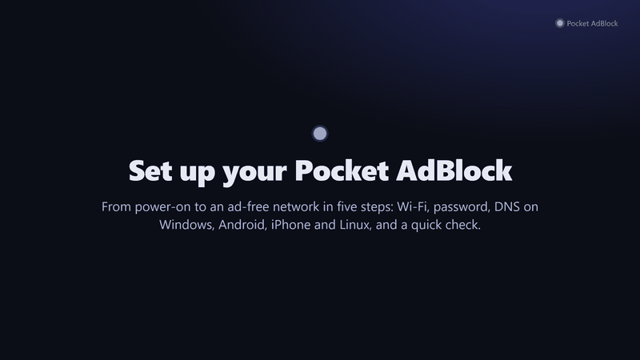

# Pocket AdBlock

[](https://github.com/joanrra2/pocket-adblock/actions/workflows/build.yml)
[](https://github.com/espressif/esp-idf/releases/tag/v6.1)
[](LICENSE)
[](https://ko-fi.com/joanramon)

A Pi-hole-style **DNS ad-blocker and Wake-on-LAN node** for a few-dollar ESP32,
written in plain **ESP-IDF v6.1** (no Arduino). It runs on a $2 ESP32-C3 with no
PSRAM, and takes advantage of PSRAM when the board has it.

- **~216k domains on a 4 MB C3, ~2.5M on 16 MB boards** stored in flash as a fuse filter
  over 40-bit hashes, memory-mapped: 3 flash reads per name. No file system, no RAM index.
- **Non-blocking DNS forwarding**: one slow upstream lookup never stalls other clients.
- **Built for page loads**: 32 lookups arriving at once are all answered within ~20 ms
  (~1,500 queries/s), and an expired cached answer is served at once while it refreshes.
- **Hidden trackers caught (CNAME cloaking)**: a site's own subdomain that is an alias of
  a blocked tracker (`smetrics.ikea.com` → `…2o7.net`) is blocked too, also for cached answers.
- **Bypass protection**: Firefox's automatic DNS-over-HTTPS and iCloud Private Relay are
  told to stand down; optionally, well-known encrypted-DNS servers are blocked.
- **SafeSearch for families** (optional): Google, Bing and YouTube (moderate / strict) are
  forced into safe mode for every device, using each provider's official safe endpoint
  (looked up through the upstream every 6 h, since addresses change). Stays on when
  ad blocking is paused.
- **DNS answer cache** (4096 entries in PSRAM on boards that have it; 90 in ~17 KB of internal RAM
  otherwise, sized for real answers: 97% are 160 bytes or less).
  Answers with TTL 0 or a few seconds (some resolvers, Quad9 at times, send them) are still
  cached for 30 s, while clients see the upstream's own TTL
  (`SINKHOLE_DNS_CACHE_MIN_TTL`, 0 turns this off).
- **A/B blocklist slots**: updates go to the inactive slot and are verified
  (SHA-256, size, sort order) before going live. A bad download never replaces a working list.
- **OTA for firmware and blocklists** from the web UI, with automatic rollback if new
  firmware doesn't come up healthy. Signed release firmware (every chip but the
  classic ESP32) can install new releases by itself; lists update by themselves every few hours.
- **Never unreachable**: a WPA2 setup access point with a captive portal comes up whenever
  the uplink Wi-Fi isn't set or can't be reached; the uplink is retried forever.
- **Wake-on-LAN** for your PCs, with online status, plus **remote wake over MQTT**
  (outbound connection only, no port forwarding). Wake a PC, then connect with AnyDesk, RustDesk, RDP and so on.
- **Static memory**: tasks, stacks and tables are fixed-size members; nothing is allocated after boot.

> Built on the hash-in-flash idea from
> [M-Abozaid/esp32-c3-adblock](https://github.com/M-Abozaid/esp32-c3-adblock), whose weekly
> blocklist this firmware can use directly. This is an independent ESP-IDF rewrite,
> not an official port.

## Hardware

| Board | Status | Notes |
|---|---|---|
| ESP32-S3 with octal flash + PSRAM (WROOM-2 N16R8V / N32R16V) | tested | use the `esp32s3-octal-flash` profile, 16 MB layout (~2.5M domains, fits every list, Extended included) |
| ESP32-S3 (quad flash, with or without PSRAM) | builds in CI | PSRAM used when present |
| ESP32-C3 (SuperMini etc., 4 MB, no PSRAM) | builds in CI | the original $2 target |
| ESP32 (classic), ESP32-C6 (4 MB) | builds in CI | |
| ESP32-C6 with 8 MB flash (DevKitC-1 N8, WROOM-1 N8) | builds in CI | use the `esp32c6-8mb` profile, 8 MB layout (~830k domains, fits the Aggressive and Strict lists) |

Power it from a stable USB supply. Many routers have a spare USB port that is enough.

## Install from the browser

Open the **[web installer](https://joanrra2.github.io/pocket-adblock/)** in Chrome or Edge,
pick your board and press *Connect and install*. No toolchain needed.

## Build & flash

Requires [ESP-IDF v6.1](https://docs.espressif.com/projects/esp-idf/en/v6.1/).

```bash
# ESP32-C3 / generic S3 / ESP32 (4 MB layout)
idf.py set-target esp32c3
idf.py build flash monitor
```

```bash
# ESP32-C6 with 8 MB flash (e.g. DevKitC-1 N8): bigger blocklist slots
idf.py -B build-c6-8 -D SDKCONFIG=build-c6-8/sdkconfig   -D SDKCONFIG_DEFAULTS="sdkconfig.defaults;boards/esp32c6-8mb.defaults"   set-target esp32c6 build flash monitor
```

```bash
# ESP32-S3 with octal flash (e.g. N32R16V): its own build dir + profile
idf.py -B build-s3 -D SDKCONFIG=build-s3/sdkconfig \
  -D SDKCONFIG_DEFAULTS="sdkconfig.defaults;boards/esp32s3-octal-flash.defaults" \
  set-target esp32s3 build flash monitor
```

### Editions and optional features

Features that cost extra RAM are chosen at build time in **[`FEATURES.cfg`](FEATURES.cfg)**
at the top of the project: one `ENABLE_… = 1/0` line each, with its RAM cost.
Edit it and rebuild; it wins over `menuconfig` for these options.

Releases come in two editions, built from [`flavours/`](flavours) and each kept up to
date by the online updater:

| Edition | Extras | Boards | Release images / update key |
|---|---|---|---|
| **Lite** | none | every board (ESP32-C3, ESP32-C6, boards without PSRAM) | `pocket-adblock-<board>-…` / `<board>` |
| **Pro** | all of the table below | ESP32-S3 with PSRAM, ESP32-WROVER | `pocket-adblock-<board>-pro-…` / `<board>-pro` |

A device only installs updates of its own edition. Builds made from `FEATURES.cfg`
are *custom*: they never pick up release images by themselves (manual upload in the
web UI still works). To switch edition, flash the other one once (browser installer
or firmware upload).

| `FEATURES.cfg` | Editions | RAM | Recommended for |
|---|---|---|---|
| `ENABLE_LONG_HISTORY` (+ `LONG_HISTORY_ENTRIES`, 4096) | Lite off (32 queries), Pro on | 76 B per entry, PSRAM | boards with PSRAM (on in the octal S3 profile, 4096) |
| `ENABLE_DNS_OVER_TLS` | Lite off, Pro on | ~26 KB internal while connected (closes after 2 min idle) + 6 KB task | boards with PSRAM; not the C3. Encrypted upstream (port 853); on the S3 uncached lookups were no slower than plain UDP |
| `ENABLE_TOP_DOMAINS` (+ `TOP_DOMAINS_ENTRIES`, 2048) | Lite off, Pro on | ~60 B per counter, PSRAM only (~120 KB) | boards with PSRAM; turns itself off without it. Top allowed / blocked domains on the overview (top clients are always shown) |
| `ENABLE_BLOOM_FILTER` (bits per entry: `menuconfig`, 10) | Lite off, Pro on | ~1.25 B per slot entry: ~270 KB (4 MB layout), ~1 MB (8 MB), ~2.7 MB (16 MB) | boards with PSRAM; not the C3 (it needs that RAM for HTTPS). On an S3: not-listed lookups 80.8 → 54.7 µs |

Prebuilt images for every board are attached to each
[release](../../releases): flash `*-full.bin` at `0x0` the first time.

> **Windows:** keep the project in a short path such as `C:\src\pocket-adblock`.
> Managed components have deep paths and fail past Windows' 260-character limit.

## First setup

<p align="center"></p>

<p align="center">85-second walkthrough · <a href="docs/media/setup-en.mp4">MP4</a> · En español: <a href="docs/media/setup-es.gif">GIF</a> · <a href="docs/media/setup-es.mp4">MP4</a></p>

1. Join the Wi-Fi **`Sinkhole-XXXX`** (password `sinkhole-setup`). Phones show
   "Sign in to network" and open the setup page by themselves (captive portal);
   otherwise open **http://192.168.4.1**. Log in as `admin` / `sinkhole`.
2. **Settings → Your Wi-Fi:** enter your network. Once it connects, the page shows the
   device's new address and the setup AP switches off 30 s later.
3. Change the admin password and the setup AP password (Settings). A banner reminds
   you while the default admin password is still set.
4. Point your router's DHCP DNS, or individual devices, at the device's address
   (also reachable as **http://sinkhole.local**).

### Point devices at it

The router is the best place: every device is covered at once (*LAN / DHCP server →
DNS server* = the device's address, second DNS empty). One device at a time:

| | Where |
|---|---|
| Windows 11 | *Settings → Network & internet → Wi-Fi* (or Ethernet) *→ Hardware properties → DNS server assignment → Edit → Manual*, IPv4 on, Preferred DNS |
| Android | *Settings → Network & internet → Internet →* ⚙ next to your Wi-Fi *→ Edit → Advanced options → IP settings: Static*, DNS 1. Also set *Private DNS* to Off or Automatic. Menu names vary by brand |
| iPhone / iPad | *Settings → Wi-Fi →* ⓘ *→ Configure DNS → Manual*, remove the others, *Add Server* |
| Linux (NetworkManager) | `nmcli con mod "<connection>" ipv4.dns <address> ipv4.ignore-auto-dns yes` then `nmcli con up "<connection>"`; or *Settings → Wi-Fi →* ⚙ *→ IPv4*, DNS Automatic off |

### Make sure nothing bypasses it (IPv6!)

Devices use whatever DNS servers the network hands them, and they hand out **two**
kinds: IPv4 (DHCP) and IPv6 (router advertisements / DHCPv6). If your router
advertises its own or your ISP's IPv6 DNS, phones and PCs quietly use that one and
ads come back, even though the IPv4 DNS points here. Pick one:

- In the router, set the advertised IPv6 DNS (RDNSS/DHCPv6) to this device: it answers
  DNS over IPv6 too, at the addresses listed under *Network* on the overview, or
- turn off IPv6 DNS advertisement / IPv6 on the LAN if you don't need it.

When the network routes IPv6 (the device gets a global address by SLAAC) the
overview shows a reminder about this.

Browsers and phones can also skip local DNS with their own encrypted DNS.
*Settings → Bypass protection* handles the automatic cases:

- **Tell browsers and phones to use this DNS** (on by default) answers the official
  canary domains with NXDOMAIN: Firefox then turns off its automatic DNS-over-HTTPS
  (`use-application-dns.net`) and Apple devices turn off iCloud Private Relay
  (`mask.icloud.com`). Chrome and Edge only upgrade to encrypted DNS when the system
  resolver supports it, which this one doesn't.
- **Block known encrypted-DNS servers** (off by default) also blocks the names of
  well-known DNS-over-HTTPS/TLS servers (Google, Cloudflare, Quad9, NextDNS, AdGuard…),
  for apps and browsers set to one by hand. A phone with *Private DNS* set to one of
  them loses Internet until it is set back to *Automatic* or *Off*. Domains on the
  allow list still pass.

Both pause together with blocking. A browser set by hand to an encrypted-DNS server
by IP address can't be stopped by DNS: set it to "use the system's DNS" / off.

### Wi-Fi behaviour and recovery

| Situation | What happens |
|---|---|
| No uplink configured | Setup AP on, captive portal |
| Uplink not found / wrong password / lost | Setup AP comes back on; the uplink is retried forever (1 s → 60 s backoff, every 60 s while someone is on the setup AP); the reason is shown in the UI |
| Uplink connected | Setup AP off after 30 s (or always on, if you choose so in Settings) |
| Hold **BOOT** 3 s | Setup AP on for 15 minutes, e.g. if you forgot the device's address |
| Hold **BOOT** 10 s | Factory reset: settings erased (the blocklist is kept) |

Settings also has **Reconnect now** and **Forget** for the uplink.

By default the blocklist checks for a new version every 6 h; this project rebuilds
its lists daily (see [How blocklists are updated](#how-blocklists-are-updated)). You can pick another list or URL, or upload your own, under **Updates**.

### Local names

*Settings → Local names* gives devices on your network a name and can hand whole
suffixes to another DNS server:

- **Name → address**: `nas.home → 192.168.1.10`. Answered locally (TTL 60 s); exact
  name only. Also overrides blocking for that one name.
- **Suffix → DNS server**: `lan → 192.168.1.1` sends `lan` and everything under it to
  your router, so the names it knows from DHCP work. `in-addr.arpa → router` does the
  same for reverse lookups (IP → name). Longest suffix wins; never blocked.

24 entries by default (`SINKHOLE_MAX_LOCAL_RECORDS`, 56 bytes each).

### Device names

The device list, the query log and the top clients show a name instead of an IP when
there is one: the name you gave it with **Name** under *Devices* (kept by MAC address,
so it follows the device when its IP changes; up to 32, included in backups), else a
local name above that points at its IP, else the hostname it sent with its DHCP request
when this device is the network's DHCP server. Fixed DHCP addresses (reservations) stay
a job for the router: its DHCP server does them, and this one hands out a pool only.

## Blocklists

```bash
python3 tools/build_blocklist.py blocklist.bin                # default sources
python3 tools/build_blocklist.py big.bin URL_OR_FILE ...      # hosts / domains / ||adblock^
```

Lists get a 64-byte header with the domain count and a SHA-256, which the device
verifies before activating. Blocking a domain also blocks its subdomains, so the
builder drops names already covered by a listed parent (`ads.example.com` when
`example.com` is listed): the same names stay blocked with 2-27% fewer entries.

The default **fuse format (v4)** is a binary fuse filter: a lookup reads 3 entries
and XORs them, with no search, and it needs no bloom filter in RAM. Each entry is
just wide enough that a name not on the list matches by chance no more often than
with 40-bit hashes (at 1.6M domains: 1 in 1M per lookup, against 1 in 670k for v2). The **compact
format (v2)** stores 3 bytes per domain plus a 65 KB index and is read by every
firmware version. Measured on the ESP32-S3 with the Extended list (1.63M domains):

| | v2 compact (`--format=v2`) | v4 fuse (default) |
|---|---|---|
| File size | 4.97 MB (24.3 bits/domain) | 4.63 MB (22.7 bits/domain) |
| 4 MB / 8 MB / 16 MB layout capacity | 218k / 830k / 2.2M | 216k / 857k / 2.5M |
| Lookup in flash, listed / not listed | 9.9 / 11.2 µs | 3.4 / 3.5 µs |
| Load and check a new list | 0.42 s | 0.15 s |
| Bloom filter (Pro) | 2.7 MB of PSRAM, rebuilt in 10.8 s | not needed |

Small lists are about the same size in both formats (Normal: 430 KB); the fuse
filter is smaller from about 250k domains. Raw headerless lists from
esp32-c3-adblock (`--raw`) and v1 lists are still accepted. The **Always allow**
list wins over every blocklist.

**Which list.** *Settings → Updates → Blocklist* picks one of the daily lists this
project publishes: **Light** (StevenBlack, ~40k domains, fewest false positives),
**Normal** (default, + HaGeZi Light, ~120k), **Aggressive** (+ HaGeZi Pro, ~255k,
8 MB boards and up), **Strict** (Aggressive + HaGeZi Threat Intelligence Feeds
medium, ~600k, 8 MB boards and up) or **Extended** (Aggressive + the full Threat
Intelligence Feeds, ~2.1M, 16 MB boards). The threat feeds are malware, phishing
and scam sites, so Strict and Extended break no more sites than Aggressive. Counts are after dropping
subdomains of listed names. *Custom URL* takes any
SHBL or raw list. Strict is in the picker from firmware 0.5.2 on; older firmware can
use it as a custom URL (`…/releases/download/blocklist/blocklist-strict.bin`).

| List | Sources | Domains | File | Smallest layout |
|---|---|---|---|---|
| Light | StevenBlack | ~40k | ~150 KB | 4 MB |
| Normal (default) | + HaGeZi Light | ~120k | ~430 KB | 4 MB |
| Aggressive | StevenBlack + HaGeZi Pro | ~255k | ~850 KB | 8 MB |
| Strict | Aggressive + HaGeZi TIF medium | ~600k | ~1.8 MB | 8 MB |
| Extended | Aggressive + HaGeZi TIF | ~2.1M | ~5.7 MB (v4), ~6.5 MB (v2) | 16 MB |

The full threat feeds change by hundreds of thousands of domains from day to day.
If one day's Extended file does not fit the 16 MB slot, the daily job publishes it
with the Strict list inside (each format on its own: the v2 file is the bigger
one), and the full list comes back on the first day it fits again.

Lists that don't fit are greyed out in the picker. If one ends up configured
anyway (a backup from a bigger board, a URL typed by hand), the device reads its
header, writes nothing, keeps filtering with the list it has and switches itself
to the next smaller list (Extended → Strict → Aggressive → Normal; before 0.5.2,
Extended stepped straight down to Aggressive). Custom lists that
don't fit are refused the same way, with the reason shown under *Updates*.

The lists are derived from [StevenBlack/hosts](https://github.com/StevenBlack/hosts)
(MIT) and [HaGeZi DNS Blocklists](https://github.com/hagezi/dns-blocklists) (GPL-3.0).

**Backup and restore.** *Settings → Backup and restore* downloads one text file
with the settings, custom lists, local names, Wake-on-LAN computers and device
rules (passwords only if you tick the box) and restores it on any board.

### How blocklists are updated

No reflashing: lists travel separately from the firmware, over the air.

1. **Daily build.** Every day at 04:41 UTC a GitHub Actions job
   (`.github/workflows/blocklist.yml`) downloads the sources (StevenBlack hosts,
   HaGeZi Light / Pro / Threat Intelligence Feeds and their medium cut), builds the
   five lists (`blocklist-light.bin`, `blocklist.bin`, `blocklist-aggressive.bin`,
   `blocklist-strict.bin`, `blocklist-extended.bin`) in both formats (`blocklist.bin` is v2, `blocklist-v4.bin`
   the fuse filter, and so on), signs them when the signing key is configured, checks
   each one fits the smallest board it is offered to and has not shrunk, and replaces the files on the
   [`blocklist` release](https://github.com/joanrra2/pocket-adblock/releases/tag/blocklist).
   Firmware 0.5.0 and later fetch the `-v4` file of the list you picked and fall back
   to the v2 file if it is missing; the setting keeps the v2 name. Older firmware
   keeps fetching the v2 files, so it never gets a list it can't read.
2. **Device check.** The device asks for its list URL 10 minutes after booting and
   then every *Settings → Updates → interval* (6 h by default, so a new daily list
   arrives within a few hours). *Update now* checks at once.
3. **Nothing changed? Nothing downloaded.** It reads only the 64-byte header first.
   Same checksum and size as the active list → "already up to date": no download,
   no flash write (most checks end here, so frequent checks cost no flash wear).
   A list bigger than the board's slot is refused here too, before anything is
   written (one of this project's lists steps down to the next smaller one).
4. **Write, verify, swap.** A new list is streamed into the inactive slot (there are
   two, A and B), its SHA-256 (and signature, on signed builds) is verified, and only
   then does the filter switch to it. A failed or cut download leaves the active
   list untouched; blocking never stops during an update.

Your own **Always block** / **Always allow** lists are kept in NVS and are not
touched by list updates. *Custom URL* works the same way with any SHBL or raw list
(build one with `tools/build_blocklist.py`); *Upload* puts a file in directly.

## Status LED

*Settings → Status LED* shows the device state on the board's LED. The chip can't
tell how its board is wired, so you pick the board: the list only shows presets
for the detected chip (ESP32-S3 DevKitC-1 v1.0 / v1.1, S3-Zero, XIAO S3; C3
SuperMini, C3-DevKitM-1, C3-Zero; C6-DevKitC-1, XIAO C6; ESP32 DevKit, LOLIN32),
or choose *Custom* with type, GPIO and polarity. *Save and test* cycles the
colours so you can confirm. Pins used by flash or PSRAM are refused. Off by default.

| State | Plain LED | RGB LED |
|---|---|---|
| Setup access point | slow blink | yellow, slow |
| No Wi-Fi / uplink | very slow blink | teal, very slow |
| Downloading list / firmware | medium blink | blue |
| Failure (no list, last update failed) | fast blink | red, fast |
| Blocking paused | short flash every 3 s | orange flash |
| All good | off | dim green |

## Wake-on-LAN

Add a host under **Wake-on-LAN** (name, MAC, optional IP, port and how long to wait)
and press **Wake**. **Edit** fills the form with a host's details; saving under the same
name replaces it.

- **Online check:** with an IP the device checks the host every 30 s, by ping, or by
  TCP connect when you give a port (e.g. 3389 Remote Desktop, 22 SSH, 445 file
  sharing). The port check is more reliable (Windows drops ping by default) and
  means the service is ready. A host goes offline only after two failed checks.
- **Wake and verify:** *Wake* (also from MQTT / Home Assistant) checks first and does
  nothing if the host is already up; otherwise it sends the magic packets, checks
  every 3 s (resending at 20 s, 60 s and then every 2 minutes) and reports "online
  after N s" or "no answer after 3 min". The wait is 3 minutes unless you set another
  one for that host (1 to 60 minutes: a PC that installs updates on boot may need
  longer). **Cancel** stops waiting. The PC needs wired Ethernet with WoL enabled in
  BIOS/UEFI and on its network adapter.
- **Watch-only hosts:** leave the MAC empty and give the IP (and a port if you like)
  to only watch a device: a NAS, a printer, a camera, a server. It gets no Wake
  button. Tick **Alert me** on any host with an IP to hear when it goes offline or
  comes back ("nas is back online (offline for 12 min)"), through Notifications (Pro)
  or the MQTT `state` topic. The first check after a restart is not an alert.

**From anywhere:** set an MQTT broker in Settings (TLS recommended, e.g. a free
EMQX Cloud Serverless or HiveMQ Cloud deployment, or your Home Assistant's Mosquitto). Then:

| Topic | Direction | Payload |
|---|---|---|
| `sinkhole/wol/<name>/set` | you → device | anything: wakes `<name>`; `cancel` stops waiting |
| `sinkhole/wol/<name>/state` | device → you | `online` / `offline` (retained) |
| `sinkhole/wol/<name>/result` | device → you | `waking`, `online after 41 s`, `no answer after 3 min`, `cancelled`, `already online`... (retained) |
| `sinkhole/status` | device → you | `online` / `offline` (LWT, retained) |
| `sinkhole/blocking/set` | you → device | `ON` / `OFF` |
| `sinkhole/blocking` | device → you | `ON` / `OFF` (retained, on every change) |
| `sinkhole/stats` | device → you | `{"blocked","allowed","percent","domains","clients","uptime","restart"}` every 60 s |

```bash
mosquitto_pub -h broker -p 8883 -u user -P pass -t sinkhole/wol/office-pc/set -m wake
```

**Phone app:** [Pocket Wake](https://github.com/joanrra2/pocket-wake) (Android, and a web
app for iPhone and any browser) wakes these hosts from your phone and shows when they come
online. Under *Wake-on-LAN → Phone app*, the device shows a QR code with the broker
address, port and topic prefix: scan it in the Android app, or with the iPhone camera to
open the web app already filled in. The code never contains a password; give the phone
its own broker login and type its password in the app.

Step by step, from creating a free EMQX Cloud broker to the first wake, with a
two-minute video: [Pocket Wake setup guide](https://github.com/joanrra2/pocket-wake/blob/main/docs/SETUP.md).

### Home Assistant

With **Show in Home Assistant** ticked (default) and the broker your Home Assistant
uses, a *Pocket AdBlock* device appears by itself (MQTT discovery): a **Blocking**
switch, sensors for blocked / allowed queries, blocked share, blocklist size,
active clients, uptime and the last restart reason, and for every Wake-on-LAN host a **Wake** button plus an **online**
sensor (hosts with an IP). Adding or removing hosts updates Home Assistant within
a few seconds. MQTT changes apply after a restart.

## Notifications and remote commands (Pro)

*Settings → Notifications* sends alerts to your phone through
[ntfy](https://ntfy.sh) (free app, no account) and/or a Telegram bot, and can take a
few commands back. Outgoing HTTPS only, nothing to open on the router.

- **ntfy:** press **Generate** for a random topic (it works like a password: anyone
  who knows it can read the alerts), save, and subscribe to that topic in the ntfy
  app. Commands go to `<topic>-cmd`: subscribe to it too and send from there. A
  self-hosted ntfy server and an access token work as well.
- **Telegram:** create a bot with [@BotFather](https://t.me/BotFather), paste its token,
  save, send `/start` to the bot, then press **Find** to fill in your chat ID. Only that
  chat can send commands.
- **Alerts** (each one can be switched off): a crash, watchdog reset or power dip, and
  firmware updates; wake results ("office-pc: online after 41 s"); hosts with
  **Alert me** going offline or coming back; other computers going online or offline
  (off by default); failed blocklist updates; Wi-Fi back after an outage of 2 minutes
  or more.
- **Commands** (off until you tick *Accept commands*): `help`, `status`, `hosts`,
  `wake NAME`, `cancel NAME`, `pause [minutes]` (15 by default), `resume`. Telegram's
  `/wake NAME` form works too. Only saved Wake-on-LAN hosts can be woken, and nothing
  else on the device can be changed this way.
- **Cost:** about 30 KB of internal RAM per service while connected (commands are
  checked every 15 s over a kept-open connection), plus a 6 KB task. That is why it is
  in the Pro edition only (`ENABLE_NOTIFY` in `FEATURES.cfg` for your own builds).
- Tokens are never shown again in the UI or the API, and backups leave them out
  unless *include passwords* is ticked.

## Updates

- **Firmware:** upload `build/pocket-adblock.bin` (or a release's `*-ota.bin`) under
  **Updates**. The new image stays on probation for 60 s and the bootloader rolls back if it crashes first.
- **Blocklist:** **Download now**, upload a `.bin`, or let the schedule run.
- **Restarts:** *Updates → Firmware* lists the last 10 restarts with the reason
  (power on, crash, watchdog, power dip, firmware update, settings restored, restart
  from the web UI...), the firmware version and how long each one ran, so a board that
  restarts by itself is easy to spot. Times come from NTP (`pool.ntp.org`, set with
  `SINKHOLE_NTP_SERVER`; empty turns the clock off) and are shown in your browser's
  time zone. Only a power cut loses the time of the boot it ended.
- **Device log:** *Updates → Device log* shows what the firmware prints on the serial
  port, live, with warnings and errors highlighted, and downloads it as a text file:
  the last 64 KB on boards with PSRAM, the last 4 KB (about 40 lines) otherwise.
  Restarts clear it (the restart list above keeps why).

### Online updates and signing

Release firmware checks `manifest.json` from the latest GitHub release 2 minutes
after booting and then once a day (*Updates → Online updates*, where *Check now*
asks at once) and offers **Install**. With *Install updates automatically* on (off
by default), a new release installs itself at that check instead.

| What | How | Effect |
|---|---|---|
| Signed blocklists | `tools/keys.py blocklist-key keys/bl.pem`, put the printed `CONFIG_SINKHOLE_BLOCKLIST_PUBKEY` line in your sdkconfig, build lists with `--sign=keys/bl.pem` | signed lists are verified (ECDSA P-256); with `SINKHOLE_BLOCKLIST_REQUIRE_SIGNED` unsigned/raw lists are refused |
| Signed firmware | `tools/keys.py firmware-key keys/firmware_signing.pem`, add `boards/signed-firmware.defaults` | OTA only accepts images signed with that key (RSA-3072); unlocks automatic install. ESP32-S3, C3 and C6 (the classic ESP32 supports RSA signing from chip revision 3) |
| Automatic install | *Install updates automatically* (signed builds only) | new releases install themselves, with the usual 60 s health probation and rollback |

No eFuses are burned: a board can always be re-flashed over USB. In CI, the
`FIRMWARE_SIGNING_KEY` and `BLOCKLIST_SIGNING_KEY` secrets (and the
`BLOCKLIST_PUBKEY` variable) turn signing on for releases and the daily lists.
Release images are signed from 0.5.1 on, except for the classic ESP32. A board running
a signed release only accepts updates signed with the same key, so local builds go
over USB or are built with that key. A board on 0.5.0 or older (unsigned) installs
0.5.1 or later once with **Install**; from then on it can update itself. The classic
ESP32 keeps offering **Install** for each release.

## Security

Plain HTTP on the LAN, the same trust model as the original project. Every API call
needs HTTP Basic auth, and every change also needs an `X-Requested-With` header, which
blocks CSRF via cached credentials. Change the default passwords. The setup AP uses WPA2.

- **The admin password is stored as a hash** (PBKDF2-HMAC-SHA256, 10,000 rounds, random
  salt), not in plain text. Checking it takes about 1 s, once after each restart or
  password change; the accepted login is then remembered, so pages stay fast.
- **Wrong passwords slow down.** After 5 different wrong passwords in a row, the device
  answers `429` with a `Retry-After` wait before it checks another one: 5 s, then 10 s,
  doubling up to 10 minutes. The right password keeps working meanwhile, and a page
  retrying the same wrong password doesn't count again. Each try is logged with the
  client's address.
- **While the default password is set**, the API only answers when the page was opened
  by the device's IP address, a single-word name, or a local name (`.local`, `.lan`,
  `.home`, `.home.arpa`, `.internal`). This stops a web page from reaching the device
  through DNS rebinding with the published default password.
- **Upgrading from 0.5 or older** hashes the existing password at the first boot. The
  plain copy is kept until the new firmware passes its 60 s check, so an automatic
  rollback can still log in, and is then erased. To go back to 0.5 or older by hand
  later, first set the admin password to the default (`sinkhole`), which is kept as
  is; otherwise the old firmware accepts no admin password until a factory reset
  (hold BOOT 10 s, which also erases Wi-Fi and settings).
- Backups leave the hash out unless *include passwords* is ticked. Restoring a file
  without passwords keeps the device's current ones; restoring an older backup that
  holds a plain password hashes it.

## Pocket AdBlock or Pi-hole?

Both forward allowed queries to an upstream resolver (Pi-hole's default too) and
answer blocked names locally. Measured from a PC over Wi-Fi, the same name 200 times:

| Who answers | p50 | p99 |
|---|---|---|
| Pocket AdBlock (ESP32-S3, cached answer) | 2.0 ms | 7.1 ms |
| Pocket AdBlock, blocked name | 1.9 ms | 5.8 ms |
| The home router's DNS (wired) | 1.1 ms | 9.7 ms |
| Quad9 directly | 13.0 ms | 13.2 ms |

The Wi-Fi hop costs about 1 ms against a wired box; repeat lookups are ~6x faster
than asking a public resolver. Lists update by themselves over Wi-Fi (no reflashing):
a daily list costs one download when it changed and a 64-byte check otherwise.

**Pick Pocket AdBlock** for a ~3-8 EUR device that draws well under a watt, has no SD
card to wear out, boots in about 2 s and needs no OS updates, with lists up to ~216k
domains (4 MB boards), ~857k (8 MB) or ~2.5M (16 MB ESP32-S3 boards), plus encrypted upstream,
Wake-on-LAN and Home Assistant built in.

**Pick Pi-hole** (on a Raspberry Pi or a server) if you want multi-million-domain
lists on any hardware, regex / wildcard rules, per-group policies, long-term query
history in a database, or a wired connection by default.

## Benchmark vs esp32-c3-adblock

Same ESP32-S3 board (WROOM-2 N32R16V), same Wi-Fi, the same Normal list (140,566
domains for the original; 121,183 for ours, which drops subdomains of listed names),
measured from a wired PC with `tools/dns_bench.py`. The original (Arduino, commit at
the time of writing) was built for the S3 with an added PlatformIO env; ours is the
Pro edition.

| | esp32-c3-adblock | pocket-adblock |
|---|---|---|
| Blocked query, p50 / p99 | 5.01 / 9.17 ms | **1.92 / 5.86 ms** |
| Same allowed name again, p50 | 18.98 ms (forwarded every time) | **2.10 ms** (answer cache) |
| Throughput, 16 parallel clients | 345 queries/s | **1,472 queries/s** |
| 32 lookups at once (a page load), 20 times | most lost, clients retry after ~1 s | **none lost**, all answered in ~19 ms |
| Blocked queries while uncached names wait on the upstream, p50 / max | 47 / 402 ms (stuck behind each lookup) | **1.9 / 6.6 ms** |
| Firmware image | 1,222,688 B | **1,089,680 B** |
| Normal list file | 702,830 B | **430,180 B** |
| Free internal heap at runtime | 210 KB | 125 KB (+ cache and history in PSRAM) |

## Speed: what changed in 0.5

The device spends ~0.4 ms on a query; the rest of the ~2 ms a client sees is Wi-Fi.
Measured on the ESP32-S3 against the same build without these changes, back to back
(the "no PSRAM" column is the Lite build with PSRAM off, as on an ESP32-C3):

| | before, Pro | 0.5, Pro | before, no PSRAM | 0.5, no PSRAM |
|---|---|---|---|---|
| Throughput, 16 parallel clients | 663 q/s, 30 lost | **1,472 q/s, 1 lost** | 642-690 q/s, 30 lost | **1,534-1,555 q/s, 0-1 lost** |
| 32 lookups at once, 20 times | 495 of 640 lost | **none lost** | ~500 lost | **none lost** |
| Device time per blocked query | 639 µs | **436 µs** | 620 µs | **413 µs** |
| First lookup after a cached answer expired | ~17 ms (upstream) | **2.3 ms** | same | same |
| DNS up after boot with a 1.6M-domain v2 list | 13.0 s | **2.1 s** | - | - |
| Lowest free internal heap during the tests | - | - | 82-90 KB | 64 KB |

What does it: a 32-datagram queue per UDP socket (lwIP's 6 dropped most of a page
load), every queued query read per wake-up, non-blocking sockets, lwIP core locking,
the DNS task on its own core, one client-table lookup per query, -O2 for the per-query
code, a query-log search that no longer holds the lock the DNS task needs, serve-stale
with background refresh, and the bloom filter built after Wi-Fi is up. A list download
still slows DNS while flash is being written (blocked queries ~5-30 ms for ~40 s).
Build with `CONFIG_SINKHOLE_PERF=y` to see per-stage timings at `/api/perf`.

## Lite vs Pro: memory and speed

Measured on v0.4.1 with the same ESP32-S3 (WROOM-2 N32R16V, 16 MB layout), the
default Normal list (~140k domains) and `tools/dns_bench.py` from a wired PC over
the board's Wi-Fi. "Lite, no PSRAM" is the Lite build with PSRAM switched off,
which is what an ESP32-C3 or a plain ESP32 gets.

| | Lite, no PSRAM | Lite | Pro |
|---|---|---|---|
| Firmware image | 1,063,440 B | 1,072,400 B | 1,074,816 B |
| Static internal RAM (DIRAM used of 341,760 B) | 177,352 B | 183,010 B | 190,818 B |
| Free internal heap, idle / after the benchmark | 167 KB / 173 KB | 179 KB / 185 KB | 176 KB / 177 KB |
| Free PSRAM | — | 14.6 MB | 11.3 MB |
| Answer cache | 90 entries, internal | 4096, PSRAM | 4096, PSRAM |
| Blocked query, p50 / p99 | 1.98 / 7.83 ms | 1.98 / 5.41 ms | 1.99 / 10.18 ms |
| Cached answer, p50 | 1.96 ms | 2.02 ms | 1.96 ms |
| Throughput, 16 parallel clients | 692 q/s | 671 q/s | 675 q/s |
| Blocked while uncached names wait on the upstream, p50 / max | 2.0 / 7.7 ms | 2.0 / 5.7 ms | 1.95 / 5.8 ms |
| Uncached (forwarded) lookup, p50 | 42.6 ms | 43.0 ms | 41.3 ms |
| Filter time per query | 43 µs | 48 µs | 42 µs |

Speed is the same in all three: a query costs well under 0.1 ms of CPU, the rest is
Wi-Fi. Small differences between runs are Wi-Fi noise (p99 moves by a few ms from
run to run). Uncached lookups depend on your upstream. What Pro adds costs memory,
not speed: DNS over TLS (~26 KB internal while connected), top-domains counters and
the bloom filter (PSRAM). The per-client rate limit was off during the runs: one PC
sending everything would otherwise hit it.

## Architecture

```
main/main.cpp            app_main(): static App app; app.start();
components/
  core/       Config (NVS settings), static RTOS wrappers, PSRAM-aware table allocation
  blocklist/  A/B flash store (mmap), custom block/allow lists, domain filter
  dns/        DNS server (select loop, pending table), answer cache, packet helpers
  net/        Wi-Fi AP+STA manager, mDNS
  update/     firmware OTA, blocklist downloader
  web/        HTTP API + embedded gzipped UI (www/index.html)
  wol/        Wake-on-LAN, ICMP probe, MQTT bridge
  stats/      clients, ban list, recent queries
  app/        wires everything together
tools/        blocklist builder
test/host/    host unit tests (g++, no IDF)
```

Latency notes: Wi-Fi power save is disabled (modem sleep can add ~100 ms per reply),
the CPU runs at full clock, and only the DNS cache lives in PSRAM. Wi-Fi, lwIP and TLS
buffers stay in internal RAM.

## Support

If this is useful to you, you can support development on
[Ko-fi](https://ko-fi.com/joanramon) ☕

## License

MIT, see [LICENSE](LICENSE). Third-party credits: [THIRD_PARTY_NOTICES.md](THIRD_PARTY_NOTICES.md).
